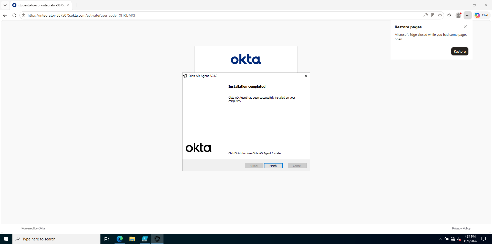
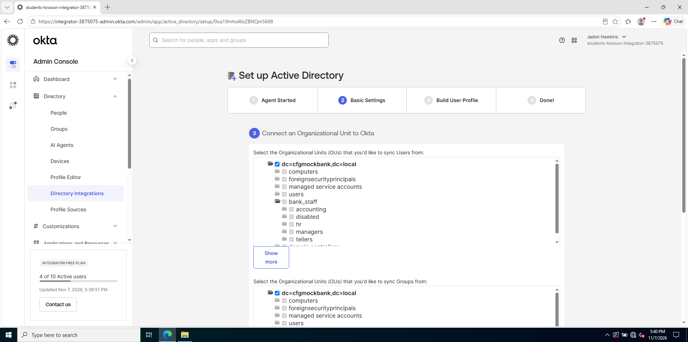
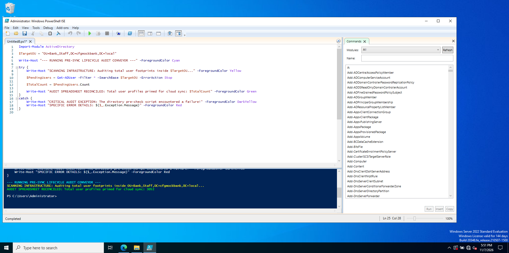
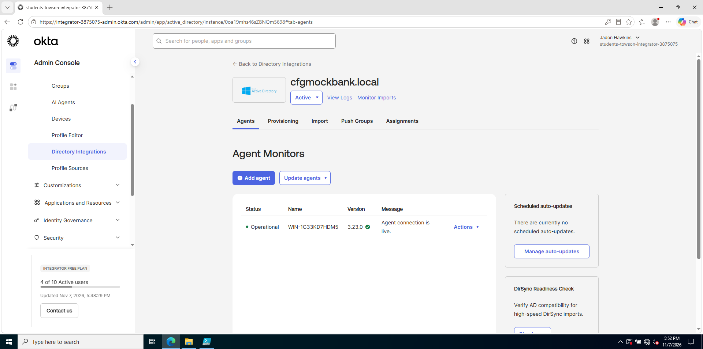

# -CFG-Mock-Bank-Identity-Hbyrid

# CFG HYBRID CLOUD IDENTITY INFRASTRUCTURE REPOSITORY

---

##  WEEKEND 1 MIGRATION MILESTONE: OKTA CLOUD DIRECTORY FEDERATION
**Current Milestone Date:** Friday, November 6, 2026  
**Active Project Objective:** Project #1 — Setting up the Hybrid Cloud Ingestion Bridge. This phase builds a secure connection between my on-premises Windows Server core and my Okta Developer Cloud tenant to prep 3,000 mock bank users for automated synchronization.

---

##  Phase 1 Architecture: Outbound Tunneling & Agent Deployment

###  1. Why I Use an Outbound Cloud Connection Agent
* **The Security Problem:** To connect 3,000 bank users from my local server to the cloud securely, I cannot open dangerous incoming firewall ports. Opening incoming ports allows external hackers to scan my network lines and attack my database core.
* **The Agent Solution:** I deployed the **Okta Active Directory Agent**. This software runs as a background service on my server. It creates a safe, one-way outbound tunnel up to my cloud admin panel. It reaches out to pull cloud tasks securely without exposing my server to the open internet.

###  2. The Step-by-Step Security Fix
* **Step 1: Troubleshooting the 1% Registry Crash:** During my initial setup, the installer crashed at the 1% mark with a **"Failed to configure Update Client"** system error. This happened because broken service links were stuck inside the operating system background memory cache.
* **Step 2: Clearing out the Stuck Configuration:** I went into my program files folder and wiped out the physical folder remnants. Next, I used my system power console to trigger a full **Server Restart**, which completely cleared out the frozen background memory tokens.
* **Step 3: Successful Software Deployment:** I passed my exact base tenant web link into the installer configurations. The wizard successfully completed the cryptographic security handshake, built its local service user account, and finished with an absolute status layout of **Installation completed**.
* **Step 4: Running the Defensive Service Validation Audit:** I used my custom PowerShell workspace to audit the Windows background layer. The script confirmed that the brand-new cloud connector engine is alive and actively running in the background.

---
# 🌐 CFG HYBRID CLOUD IDENTITY INFRASTRUCTURE REPOSITORY

---

## 🚀 WEEKEND 1 MIGRATION MILESTONE: OKTA CLOUD DIRECTORY FEDERATION
**Current Milestone Date:** Saturday, November 7, 2026  
**Active Project Objective:** Project #1 — Setting up the Hybrid Cloud Ingestion Bridge. This phase focuses on mapping organizational boundaries inside the cloud directory and running a pre-sync pipeline audit.

---

##  Phase 2 Architecture: Organizational Unit (OU) & Pre-Sync Data Audits

###  1. Why I Set Up Folder Filtering Before Synchronization
* **The Messy Data Problem:** By default, an Active Directory database is packed with hundreds of built-in computer background files and system service accounts. If I sync the whole server blindly, these junk system profiles will clutter my cloud dashboard and break compliance tracking.
* **The Filtering Solution:** I logged into my Okta Cloud Admin console and configured directory boundaries. I unchecked all default system containers and locked my configuration down to look **only** at my custom **bank_staff** folder drawer. This ensures my cloud registry remains completely clean and restricted to real human bank employees.

###  2. The Step-by-Step Security Fix
* **Step 1: Constraining Cloud Directory Scope:** I mapped my user and group sync rules inside the Okta Admin setup wizard, checking only the parent **bank_staff** directory and its operational department sub-drawers. I explicitly left default system folders like `computers`, `foreignsecurityprincipals`, and `managed service accounts` completely unchecked to protect my data scope.
* **Step 2: Confirming Live Agent Health:** I navigated to the **Agent Monitors** dashboard inside my Okta console. The panel verified a clean **Operational** status with a green checkbox, proving my outbound server tunnel is actively running version 3.23.0 in the background.
* **Step 3: Engineering a Defensive Pre-Check Tool:** I wrote an automated infrastructure audit script inside my PowerShell workspace. I wrapped the code in a defensive **try/catch** trap to ensure any unexpected active directory connection errors would get caught safely before execution.
* **Step 4: Calculating the On-Premises Launchpad Baseline:** I ran the completed validation tool. The script scanned my database folders from the top down and recorded an exact user baseline score: **3,052 identity cards are completely primed for cloud sync**.

---
